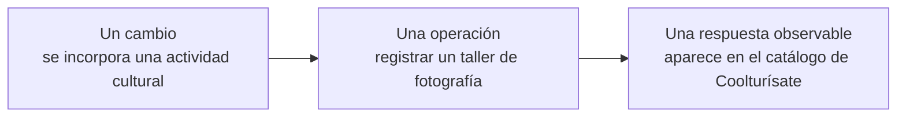
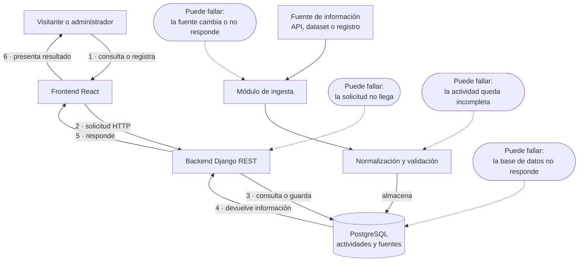
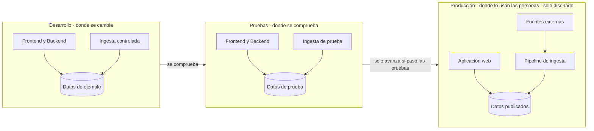
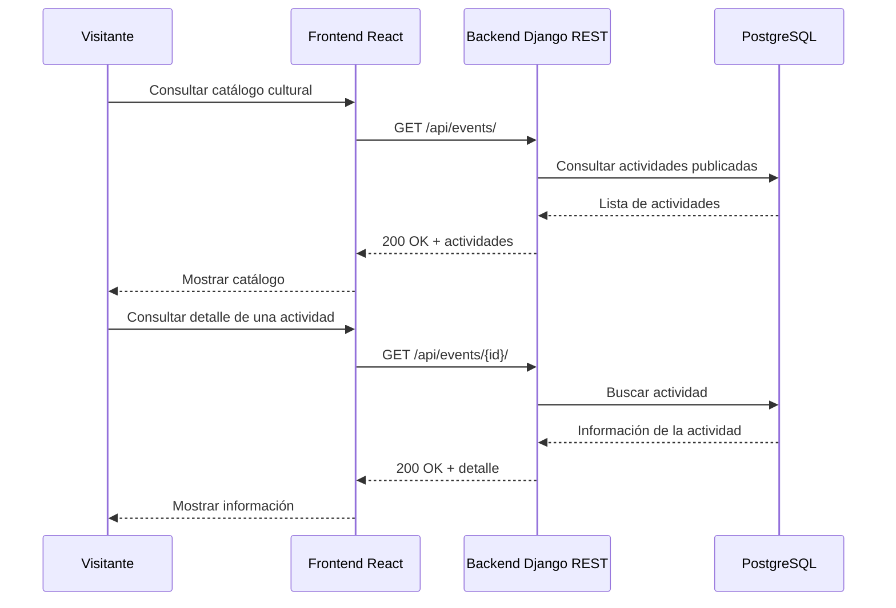
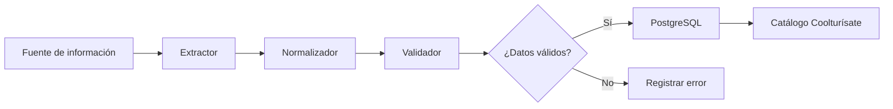

# coolturisate

Plataforma web para descubrir, centralizar y conectar a las personas con la oferta cultural, artística y ciudadana de Medellín.

**Versión del README:** 0.2 · **Autoría:** Jhon Jairo Pulgarín · **Última revisión:** 23 de noviembre de 2026

---

## 1. Qué es y para quién

Coolturísate es una plataforma de descubrimiento cultural que centraliza información sobre eventos, actividades, espacios y experiencias culturales de Medellín.

Su propósito es facilitar que las personas encuentren qué hacer, dónde hacerlo y cómo participar en la vida cultural de la ciudad, reuniendo información que actualmente se encuentra distribuida entre diferentes instituciones, organizaciones y plataformas.

- **Ámbito:** cultura, arte, patrimonio, ciudadanía y participación comunitaria en Medellín.
- **Quién lo usa:** ciudadanos, jóvenes, estudiantes, turistas y personas interesadas en actividades culturales. También administradores que gestionan y verifican la información publicada.
- **Quién aporta información:** instituciones culturales, museos, teatros, colectivos artísticos, organizaciones comunitarias y fuentes públicas de información.
- **Quién no necesita registrarse:** los visitantes que únicamente desean explorar el catálogo de actividades.
- **Qué necesita poder hacer quien lo usa:** encontrar actividades relevantes, consultar sus detalles, conocer su ubicación y acceder a la información original para participar.

## 2. Qué puede fallar

| Cuando cambia… | Qué deja de funcionar | Quién lo nota | Cómo se entera |
|---|---|---|---|
| Una fuente externa modifica su estructura | El extractor deja de obtener correctamente las actividades | Administrador y visitantes | Al revisar la última actualización o detectar errores de extracción |
| Una actividad cambia de fecha o se cancela | Se muestra información desactualizada | Visitantes y organizadores | Cuando alguien consulta la fuente original o reporta el error |
| Se importan varias veces los mismos registros | Aparecen actividades duplicadas | Visitantes y administrador | Al encontrar actividades repetidas en el catálogo |
| La base de datos no está disponible | No se pueden consultar ni almacenar actividades | Todos los usuarios | Al intentar acceder al catálogo |
| Falla el proceso de normalización | Las actividades aparecen incompletas o con categorías incorrectas | Administrador y visitantes | Al revisar los registros importados |

## 3. El servicio pequeño

El servicio más pequeño que representa el problema: **incorporar una actividad cultural, almacenarla y permitir que una persona la encuentre en el catálogo**.

- **Qué entra:** una actividad cultural de Medellín, con título, descripción, fecha, categoría, ubicación y fuente de procedencia.
- **Operación que muestra su valor:** incorporar una actividad al sistema y consultarla posteriormente desde el catálogo.
- **Respuesta observable:** la actividad queda almacenada correctamente y aparece en el listado público con su información.
- **Si la información es inválida:** el sistema rechaza el registro o lo deja pendiente de corrección, indicando qué información falta.
- **Si la actividad ya existe:** el sistema identifica el posible duplicado y evita crear otro registro equivalente.
- **Por qué es una muestra válida:** representa el recorrido fundamental de Coolturísate: obtener información, organizarla y ponerla a disposición de las personas. Las recomendaciones, mapas y funcionalidades avanzadas pueden esperar.

Para la primera comprobación se utilizarán datos de ejemplo controlados. La integración con fuentes externas reales se incorporará cuando se haya verificado su disponibilidad y sus condiciones de acceso.

## 4. Recorrido mínimo

1. **Un cambio:** se incorpora una nueva actividad cultural al sistema.
2. **Una operación:** registrar una actividad, por ejemplo, un taller de fotografía en Medellín.
3. **Una respuesta observable:** la actividad se almacena y aparece en el catálogo público.

## 5. Arquitectura inicial

La arquitectura propuesta separa la presentación, la lógica del negocio, el almacenamiento y la incorporación de información externa.

| Pieza | Qué es | Para qué sirve |
|---|---|---|
| Frontend | Aplicación web en React | Permite explorar actividades y consultar sus detalles |
| Backend | API REST con Django y Django REST Framework | Procesa solicitudes, aplica reglas de negocio y entrega información |
| Base de datos | PostgreSQL | Almacena actividades, categorías, lugares, organizaciones y fuentes |
| Módulo de ingesta | Procesos independientes de extracción y procesamiento | Obtiene información desde fuentes externas o registros controlados |
| Normalizador | Componente de procesamiento | Convierte diferentes estructuras de información a un modelo común |
| Administrador | Usuario encargado de gestionar la plataforma | Revisa, corrige y aprueba actividades |
| Visitante | Usuario público | Consulta y descubre actividades culturales |

**Entornos:** desarrollo (donde se modifica el sistema), pruebas (donde se comprueba su comportamiento) y producción (donde lo utilizan las personas).

**Qué varía entre entornos:** la configuración, las credenciales, los servicios y los datos. En desarrollo y pruebas se utilizarán datos ficticios o controlados. En producción se manejarán datos publicados y configuraciones restringidas. Por ahora, producción solo se diseña: no se ejecuta ni se modifica con datos reales.

**Qué se conserva:** el recorrido esperado: incorporar una actividad, validarla, almacenarla y mostrarla correctamente en el catálogo.

**Dónde podría fallar una petición:** durante la recepción de información, su validación, normalización, almacenamiento o consulta desde la aplicación web. También puede fallar una fuente externa sin que necesariamente deba detenerse el resto del sistema.

Los tres entornos comparten el mismo recorrido y cambian únicamente su configuración y datos. Una versión solo avanza hacia producción si pasó las comprobaciones del entorno anterior:

## 6. Criterios de aceptación

| # | Operación | Evidencia |
|---|---|---|
| 1 | Incorporar una actividad cultural de ejemplo | El registro se almacena correctamente y se puede consultar desde la API |
| 2 | Consultar el catálogo de actividades | La actividad aparece con su título, categoría, fecha y ubicación |
| 3 | Incorporar nuevamente la misma actividad | El sistema identifica el posible duplicado y evita crear un registro repetido |
| 4 | Intentar incorporar una actividad sin información obligatoria | El sistema informa el error y no almacena un registro inválido |
| 5 | Consultar una actividad inexistente | El sistema devuelve una respuesta de recurso no encontrado |

## 7. Pruebas de aceptación

**Prueba A · se ejecuta**

- Entrada: registrar una actividad de ejemplo con título "Taller de fotografía urbana", descripción, fecha, categoría, ubicación y fuente.
- Se espera: la actividad se almacena correctamente.
- Cómo se comprueba: se consulta el registro mediante la API y se verifica que aparece en el catálogo.

**Prueba B · solo se analiza**

- Entrada: incorporar dos veces la misma actividad desde una fuente.
- Se espera: el sistema identifica el posible duplicado y evita crear dos actividades equivalentes.
- Cómo se comprueba: se revisa el diseño de la estrategia de deduplicación y sus criterios de comparación. Todavía no se ejecuta.

**Prueba C · solo se analiza**

- Entrada: una fuente externa modifica su estructura o deja de responder.
- Se espera: el extractor registra el error, conserva los datos existentes y permite que las demás fuentes continúen funcionando.
- Cómo se comprueba: se revisa el diseño del manejo de errores y aislamiento de los extractores. Todavía no se ejecuta.

## 8. Alcance

**Incluido (la cadena pequeña que se pretende ejecutar)**

- Incorporar una actividad cultural de ejemplo.
- Validar los campos obligatorios.
- Almacenar la actividad en PostgreSQL.
- Consultar las actividades mediante una API REST.
- Mostrar las actividades en un catálogo web.
- Consultar el detalle de una actividad.

**Excluido (escrito para no perder el foco)**

- **Integración con múltiples fuentes reales:** primero se comprobará el recorrido completo con datos controlados. Después se incorporarán extractores individuales.
- **Scraping masivo:** no se necesita para demostrar el funcionamiento del catálogo y requiere verificar permisos, estructuras y condiciones de acceso.
- **Mapa cultural:** es una funcionalidad importante, pero primero deben existir actividades y lugares correctamente almacenados y georreferenciados.
- **Recomendaciones con IA:** primero debe existir información estructurada y suficiente para recomendar actividades.
- **Usuarios, favoritos y perfiles personalizados:** no son necesarios para consultar el catálogo público inicial.
- **Pagos y reservas:** Coolturísate inicialmente facilita el descubrimiento y redirige a las fuentes originales. No administra transacciones.
- **Notificaciones:** pueden incorporarse posteriormente.
- **Expansión geográfica:** inicialmente solo se contempla Medellín.
- **Producción con datos reales:** se diseña, pero no se ejecuta en esta primera etapa.

## 9. Qué queda para después

Las ampliaciones esperan a tener una primera cadena completa. En orden de prioridad:

1. Integrar una primera fuente externa cuya disponibilidad y condiciones de uso hayan sido verificadas.
2. Incorporar más extractores independientes para instituciones y organizaciones culturales.
3. Implementar el sistema de deduplicación y actualización automática.
4. Desarrollar el panel administrativo para revisar y aprobar actividades.
5. Incorporar filtros avanzados y búsqueda por ubicación.
6. Desarrollar el mapa cultural de Medellín.
7. Permitir que organizaciones y colectivos publiquen directamente sus actividades.
8. Incorporar usuarios, favoritos y preferencias culturales.
9. Implementar recomendaciones y búsquedas mediante inteligencia artificial.
10. Evaluar la expansión a otros municipios de Antioquia.

## 10. Qué está comprobado y qué no

| Afirmación | Estado |
|---|---|
| Coolturísate busca centralizar la oferta cultural de Medellín | definido como visión del producto |
| El catálogo permitirá consultar actividades culturales | propuesto |
| La arquitectura contempla React, Django REST y PostgreSQL | propuesta técnica |
| El modelo de datos unificará actividades de diferentes fuentes | diseñado conceptualmente |
| El sistema podrá incorporar información mediante APIs, datasets y scraping | propuesto, sujeto a verificación por fuente |
| Una actividad de ejemplo se almacena y aparece en el catálogo | pendiente de ejecución |
| El sistema detecta actividades duplicadas | solo diseñado |
| Los extractores funcionan de manera independiente | solo diseñado |
| El sistema mantiene la información actualizada automáticamente | solo propuesto |
| El mapa cultural permite consultar espacios y actividades | solo propuesto |
| Las recomendaciones mediante IA funcionan | solo propuesto |
| Una versión solo llega a producción si pasó las pruebas | solo diseñado |

**Nota:** el estado de las afirmaciones deberá actualizarse a medida que avance el desarrollo. No se debe marcar una funcionalidad como ejecutada únicamente porque el código fue generado.

## 11. Recursos y accesos

- **Con qué se plantea trabajar:** computador de desarrollo, repositorio Git, datos culturales de ejemplo y herramientas de desarrollo.
- **Tecnologías propuestas:** React, Tailwind CSS, Django, Django REST Framework y PostgreSQL.
- **Qué se necesita investigar:** disponibilidad de APIs, conjuntos de datos abiertos, feeds y páginas institucionales que permitan obtener información cultural.
- **Fuentes potenciales:** MEData, Secretaría de Cultura Ciudadana, agendas culturales institucionales, museos, teatros, bibliotecas y organizaciones independientes.
- **Qué no está confirmado:** acceso a APIs específicas, credenciales de servicios externos, acuerdos con instituciones y permisos para automatizar la extracción de información.
- **Qué operación del caso real quedaría sin comprobar:** la extracción periódica de actividades reales desde diferentes organizaciones y la actualización de información ante cambios en sus fuentes originales.

## 12. Quién cambia, quién aprueba, quién observa

| Rol | Quién |
|---|---|
| Quién cambia el servicio | El equipo de desarrollo, apoyado por agentes de IA especializados |
| Quién define los requisitos y prioridades | Product Owner |
| Quién aprueba los cambios arquitectónicos | Responsable técnico del proyecto |
| Quién aprueba que una funcionalidad avance | Product Owner, después de revisar los criterios de aceptación y las pruebas |
| Quién verifica la calidad | Responsable de QA y equipo de desarrollo |
| Quién observa si funciona | Visitantes del catálogo y administradores de Coolturísate |

Los agentes de IA pueden analizar, planificar, desarrollar y verificar tareas, pero las decisiones relevantes y la aprobación de entregables permanecen bajo supervisión humana.

## 13. Aportes

Si se trabaja con otras personas, registrar quién realizó cada aporte y qué parte del proyecto desarrolló.

También se pueden registrar las responsabilidades de los agentes de IA utilizados en el desarrollo.

| Persona o agente | Responsabilidad | Aporte visible |
|---|---|---|
| Por definir | Product Owner | Visión, requisitos y priorización |
| Por definir | Arquitectura | Diseño técnico y decisiones arquitectónicas |
| Por definir | Backend Developer | API, modelos y lógica de negocio |
| Por definir | Frontend Developer | Catálogo e interfaz web |
| Por definir | Data Engineer | Extractores y procesamiento de información |
| Por definir | QA Engineer | Pruebas y criterios de aceptación |

## 14. Bosquejo técnico (opcional)

> **Solo si ya avanzaste.** Si todavía no has implementado estos componentes, puedes utilizar esta sección como referencia del diseño inicial.

El mismo recorrido, visto a nivel de solicitudes al servicio:

### Endpoints iniciales propuestos

| Pedido | Qué hace | Respuesta esperada |
|---|---|---|
| `GET /api/events/` | Lista las actividades publicadas | 200 + listado de actividades |
| `GET /api/events/{id}/` | Consulta el detalle de una actividad | 200 + información · 404 si no existe |
| `POST /api/events/` | Incorpora una actividad mediante el mecanismo autorizado | 201 si se crea · 400 si los datos son inválidos |
| `GET /api/categories/` | Consulta las categorías disponibles | 200 + listado de categorías |
| `GET /api/places/` | Consulta los espacios culturales | 200 + listado de lugares |
| `GET /api/health/` | Indica si el servicio responde | 200 + estado del servicio |

### Flujo inicial de ingesta

Lo que este bosquejo **no incluye todavía, a propósito**: implementación de extractores reales, configuración de tareas programadas, integración con múltiples proveedores, autenticación administrativa, empaquetado, despliegue y monitoreo de producción. Estos elementos se definirán e implementarán progresivamente.

## 15. Cómo leer este README

Una persona que no conoce Coolturísate debería poder responder, sin preguntarle a quien lo desarrolló:

1. ¿Qué problema cultural busca resolver la plataforma y a quién está dirigida?
2. ¿Qué operación demuestra que Coolturísate puede centralizar y presentar información?
3. ¿De dónde proviene la información cultural y cómo se incorpora al sistema?
4. ¿Qué se comprobó realmente y qué solamente está diseñado o propuesto?
5. ¿Qué funcionalidades forman parte del alcance inicial y cuáles se dejan para después?
6. ¿Quién desarrolla, quién aprueba y quién verifica que el sistema funciona?

El objetivo de este README es mantener una descripción clara del producto, su alcance y su estado real de desarrollo, sirviendo como referencia tanto para las personas del equipo como para los agentes de IA que participen en su construcción.
